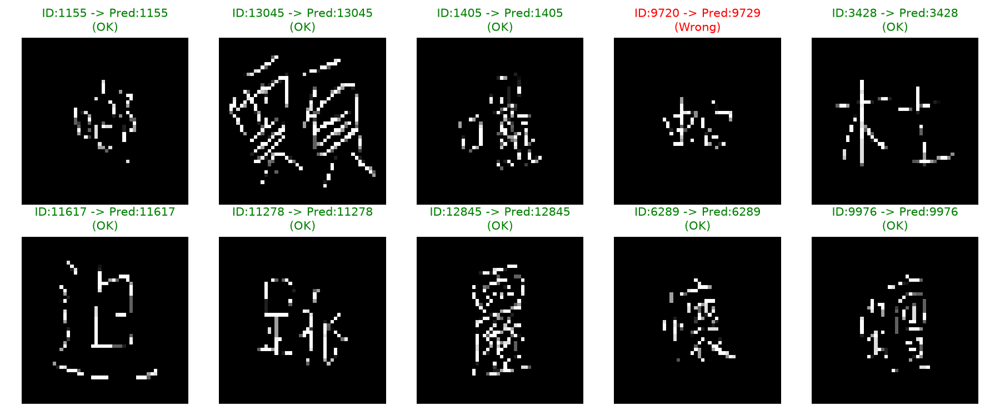

# DIT5411 - Traditional Chinese Handwriting Recognition (13,065 Characters)

## 1. Project Overview
This project develops and compares multiple Convolutional Neural Network (CNN) architectures using **TensorFlow** and **OpenCV** to recognize **13,065 Traditional Chinese characters** from handwritten images. To ensure a realistic and leak-free evaluation, the dataset is strictly split prior to data augmentation, and four model configurations with varying depths, architectures, and regularization strategies are evaluated.

---

## 2. Dataset & Train/Test Split
* **Source**: [AI-FREE-Team Traditional Chinese Handwriting Dataset (Full 13,065 Characters)](https://github.com)
* **Total Classes**: 13,065 Traditional Chinese characters (`684,677` images in total).
* **Strict Splitting Strategy (No Data Leakage)**:
  * **Training Set**: First **40 images** per character (`522,127` raw images).
  * **Testing Set**: Remaining ~10 images per character (`162,550` unseen images), kept completely untouched during augmentation and training.

---

## 3. Image Preprocessing & Data Augmentation (OpenCV)
1. **Preprocessing**: All images are loaded in grayscale using OpenCV (`cv2.imread`), resized uniformly to **`48 × 48` pixels**, and pixel-inverted so strokes are represented as foreground (`1.0`) on a zero background (`0.0`).
2. **Data Augmentation**: Each character's 40 training images are augmented **5×** to **200 images per character** (`2,610,635` training samples per epoch) using random affine transformations:
   * **Random Rotation**: ±7° to ±10°
   * **Random Translation**: ±2 to ±3 pixels (horizontal & vertical)
   * **Random Scaling / Zoom**: 0.90× – 1.10×

---

## 4. Model Architectures & Iterative Optimization
Four models with progressive architectural complexity were built and evaluated:

1. **Model 1 (`Model_1_Basic_CNN`)**: A shallow 2-layer baseline CNN (`Conv2D` → `MaxPooling` → `Flatten` → `Dense(512)` → `Dropout(0.3)`).
2. **Model 2 (`Model_2_Deep_VGG_CNN`)**: A deeper 4-layer VGG-style CNN incorporating `BatchNormalization` after every convolution and `GlobalAveragePooling2D` to reduce fully connected parameters.
3. **Model 3a (`Model_3_ResNet` - Initial)**: A 10-layer Residual Network with 3 residual blocks (skip connections) trained with a fixed learning rate (`1e-3`) and no weight decay.
4. **Model 3b (`Model_3_Optimized_ResNet` - Final)**: An improved ResNet addressing the overfitting observed in Model 3a by adding **L2 weight regularization (`1e-4`)**, a wider **`Dense(1024)`** feature bottleneck layer, `Dropout(0.5)`, and **`ReduceLROnPlateau`** dynamic learning rate scheduling.

---

## 5. Experimental Results & Comparison (Testing Set: 162,550 Images)

| Model Name | Architecture Highlights | Input Size | Test Loss | Testing Accuracy |
| :--- | :--- | :---: | :---: | :---: |
| **Model 1: Basic CNN** | 2 Conv layers + Flatten + Dense(512) | 48 × 48 | — | **36.76%** |
| **Model 2: Deep VGG-like CNN** | 4 Conv layers + BatchNorm + GlobalAvgPool | 48 × 48 | — | **54.87%** |
| **Model 3a: ResNet (Initial)** | 10-layer Residual Net (Fixed LR, No L2) | 48 × 48 | 10.9600 | **41.88%** |
| **Model 3b: Optimized ResNet** | **10-layer ResNet + L2 Reg + Dense(1024) + LR Decay** | **48 × 48** | **1.1112** | **78.93%** |

### Key Findings & Analysis
* **Depth & Normalization**: Moving from a shallow 2-layer CNN (`36.76%`) to a 4-layer VGG-like network with `BatchNormalization` (`54.87%`) significantly improved stroke feature extraction across 13,065 classes.
* **Overfitting vs. Regularization in Deep ResNets**: Without regularization and learning rate decay, the initial 10-layer ResNet memorized the training set (`92.53%` train accuracy) while oscillating on the unseen test set (`41.88%`). Introducing **L2 regularization**, a **`Dense(1024)` bottleneck** to handle the 13,065-class output space, and **`ReduceLROnPlateau`** stabilized convergence and boosted unseen testing accuracy to **78.93%**.

---

## 6. Sample Predictions on Unseen Testing Set
Below is a random sample of 10 unseen handwriting images from the Testing Set predicted by **`Model_3_Optimized_ResNet`** (9/10 correct, including complex high-stroke Traditional Chinese characters):

---

## 7. References
* Dataset Repository: https://github.com
* OpenCV Python Tutorials: https://opencv.org
